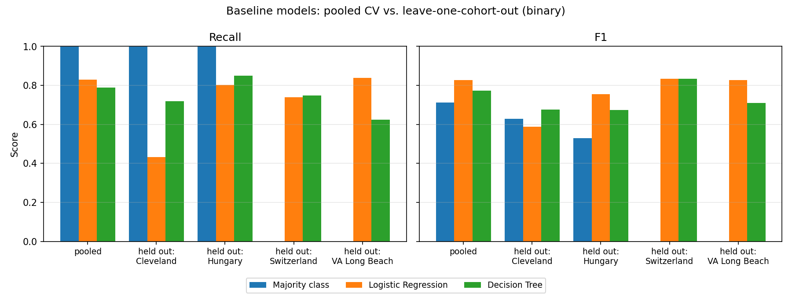
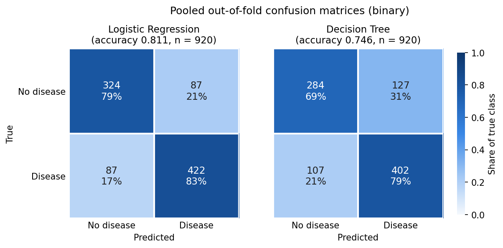
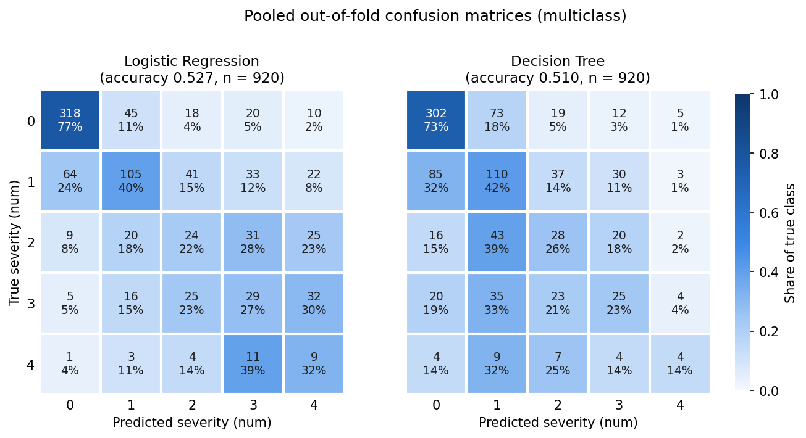

# CPTS 437 Heart Disease Prediction

**Multi-Region Cardiovascular Disease Prediction and Cross-Dataset Model Evaluation**

CptS 437 (Machine Learning) final project, Team 1, Washington State University.

Most published heart disease models are trained and tested on the Cleveland cohort alone, so their reported accuracy may not hold at other hospitals. This project builds supervised classifiers that predict whether a patient has heart disease from 13 routine clinical measurements. It then measures how well those models generalize to patients from geographically distinct sites, where much of the data is missing.

## Team

| Member | Responsibility |
| --- | --- |
| Srishanth Reddy Surakanti | Exploratory data analysis, multi-center missing-data handling, preprocessing pipeline |
| Sai Gubba | Baseline models (Logistic Regression, Decision Tree) and cross-validation scaffolding |
| Anh Duong | Ensemble and tree-based models (Random Forest, XGBoost) and hyperparameter optimization |
| Danbi Kim | Cross-dataset generalization testing (LOCO evaluation), error analysis, metric visualization |

## Dataset

[UCI Machine Learning Repository – Heart Disease](https://archive.ics.uci.edu/dataset/45/heart+disease). We use the standard 14-attribute processed files from four sites, 920 patients in total.

| Site | File | Patients | % with disease |
| --- | --- | --- | --- |
| Cleveland Clinic Foundation | `processed.cleveland.data` | 303 | 45.9 |
| Hungarian Institute of Cardiology, Budapest | `processed.hungarian.data` | 294 | 36.1 |
| University Hospitals, Zurich and Basel | `processed.switzerland.data` | 123 | 93.5 |
| VA Medical Center, Long Beach | `processed.va.data` | 200 | 74.5 |

Each file has a header row added for the attribute names. Missing values are marked `?`. The loader accepts either `processed.<region>.data` or `processed_<region>.data`.

### Attributes

| Attribute | Description |
| --- | --- |
| `age` | Age in years |
| `sex` | 1 = male, 0 = female |
| `cp` | Chest pain type: 1 typical angina, 2 atypical angina, 3 non-anginal pain, 4 asymptomatic |
| `trestbps` | Resting blood pressure (mm Hg) |
| `chol` | Serum cholesterol (mg/dl) |
| `fbs` | Fasting blood sugar > 120 mg/dl (1 = true) |
| `restecg` | Resting ECG: 0 normal, 1 ST-T wave abnormality, 2 left ventricular hypertrophy |
| `thalach` | Maximum heart rate achieved |
| `exang` | Exercise-induced angina (1 = yes) |
| `oldpeak` | ST depression induced by exercise relative to rest |
| `slope` | Slope of the peak exercise ST segment: 1 up, 2 flat, 3 down |
| `ca` | Number of major vessels (0–3) colored by fluoroscopy |
| `thal` | 3 normal, 6 fixed defect, 7 reversible defect |
| `num` | **Target:** 0 = no disease, 1–4 = increasing severity |

The primary task is binary (`num > 0`). Predicting the severity level is a secondary task.

### Data quality notes

Cleveland is nearly complete. The other three sites are not:

- `ca` is missing for 96–99% of patients outside Cleveland.
- `thal` is missing for 42–90% of patients outside Cleveland.
- Switzerland records cholesterol as `0` for every patient. The code treats a `0` in `chol` or `trestbps` as missing.
- Roughly a quarter of VA patients are missing several vitals.

## Repository structure

```
CPTS_437_Heart_Disease_Prediction/
├── README.md
├── baseline_model.py        # baseline models + cross-validation scaffolding
├── data/
│   ├── processed.cleveland.data
│   ├── processed.hungarian.data
│   ├── processed.switzerland.data
│   └── processed.va.data
└── results/                 # created automatically when the scripts run
    ├── baseline_results_<tag>.csv
    ├── baseline_<tag>.png
    ├── confusion_<tag>.png
    └── confusion_<model>_<tag>.csv
```

## Setup

Requires Python 3.9+, scikit-learn 1.2 or newer, and matplotlib 3.5 or newer.

```bash
git clone https://github.com/ragz743/CPTS_437_Heart_Disease_Prediction.git
cd CPTS_437_Heart_Disease_Prediction
pip install numpy pandas scikit-learn matplotlib
```

## Usage

```bash
python baseline_model.py                           # binary task: disease vs. no disease
python baseline_model.py --task multiclass         # severity: num = 0–4
python baseline_model.py --drop-features ca thal   # exclude the sparsest features
python baseline_model.py --quick                   # small search grids for a fast test run
python baseline_model.py --folds 10 --jobs 4       # 10 CV folds, limit to 4 CPU cores
```

Paths are resolved from the script's location, so it reads `data/` and writes `results/` correctly from any working directory. A full run takes about 30–60 seconds on a multi-core laptop and a few minutes on a single core. `--quick` finishes in a few seconds.

The multiclass run prints a few scikit-learn warnings that the least populated class has fewer members than the number of folds. This is expected: some sites have only a handful of `num = 4` patients.

### Outputs

Each run writes the following to `results/`:

| File | Contents |
| --- | --- |
| `baseline_results_<tag>.csv` | Every metric for every model and evaluation setting |
| `baseline_<tag>.png` | Recall and F1 bar charts: pooled CV vs. each held-out region |
| `confusion_<tag>.png` | Heatmaps of the pooled out-of-fold confusion matrices for Logistic Regression and Decision Tree |
| `confusion_<model>_<tag>.csv` | Out-of-fold confusion matrix on the pooled data (raw counts) |

`<tag>` is the task name plus any dropped features (for example `binary_no_ca_thal`), so different runs don't overwrite each other. The script also prints each results table and the tuned hyperparameters to the console.

### Reusing the evaluation code

Other models can plug into the same evaluation by importing from `baseline_model.py`:

```python
from baseline_model import (
    load_all_regions,
    make_target,
    build_preprocessor,
    get_scoring,
    run_within_region,
    run_pooled,
    run_loco,
    run_train_one_test_others,
)
from sklearn.pipeline import Pipeline
from sklearn.ensemble import RandomForestClassifier

df = load_all_regions()
y = make_target(df, "binary")
models = {
    "Random Forest": Pipeline(
        [
            ("prep", build_preprocessor(scale=False)),
            ("model", RandomForestClassifier(random_state=42)),
        ]
    )
}
rows = run_loco(df, y, models, get_scoring("binary"))
```

## Methodology

**Preprocessing.** All preprocessing runs inside a scikit-learn `Pipeline` and is refit on each training split, so no information leaks from test data. The steps are:

- Median imputation for numeric features, with a flag column marking which values were missing.
- Most-frequent imputation for binary and categorical features.
- One-hot encoding for categorical features.
- Standardization for Logistic Regression only.

**Models.**

- **Majority class:** always predicts the most common training label. Any real model should beat it.
- **Logistic Regression:** tuned over regularization strength `C` and class weighting.
- **Decision Tree:** tuned over depth, minimum leaf size, and split criterion.

Hyperparameters are chosen with an inner `GridSearchCV` inside each outer training split (nested cross-validation), optimizing macro F1. Test folds never influence model selection.

**Evaluation settings.**

1. **Within-region:** stratified 5-fold CV inside each site.
2. **Pooled:** stratified 5-fold CV on all sites combined.
3. **Leave-one-cohort-out (LOCO):** train on three sites, test on the fourth.
4. **Cleveland only:** train on Cleveland and test on each other site, mirroring how most published models are built.

**Metrics.** Accuracy, precision, recall, F1 and ROC-AUC for the binary task. Macro-averaged precision, recall and F1 for the multiclass task. Recall (sensitivity) is prioritized because a missed diagnosis is costlier than a false alarm.

## Baseline results

From a full run (`python baseline_model.py`, 5 outer and 5 inner folds, seed 42). The complete tables are in `results/baseline_results_<tag>.csv`.

### Pooled 5-fold CV (binary)

| Model | Accuracy | Precision | Recall | F1 | ROC-AUC |
| --- | --- | --- | --- | --- | --- |
| Majority class | 0.553 | 0.553 | 1.000 | 0.712 | 0.500 |
| Logistic Regression | 0.811 | 0.828 | 0.829 | 0.828 | 0.897 |
| Decision Tree | 0.746 | 0.761 | 0.790 | 0.774 | 0.811 |

### Leave-one-cohort-out (binary, F1 / recall)

| Held-out site | Logistic Regression | Decision Tree |
| --- | --- | --- |
| Cleveland | 0.588 / 0.432 | 0.676 / 0.719 |
| Hungary | 0.756 / 0.802 | 0.674 / 0.849 |
| Switzerland | 0.833 / 0.739 | 0.835 / 0.748 |
| VA Long Beach | 0.828 / 0.839 | 0.710 / 0.624 |



### Confusion matrices (pooled, out-of-fold)

Each cell shows the patient count and its share of the true class. Logistic Regression misses 87 of 509 patients with heart disease (17%), and the Decision Tree misses 107 (21%).



On the multiclass task, both models separate `num = 0` from disease reasonably well but confuse the severity levels 1–4 with each other (macro F1 0.37 for Logistic Regression, 0.36 for the Decision Tree).



### Key findings

- **Pooled CV is optimistic.** Logistic Regression reaches 0.83 F1 when patients from every site are mixed into each fold, but recall falls to 0.43 when Cleveland is held out.
- **Cleveland-only models transfer poorly.** Trained on Cleveland alone, Logistic Regression detects only 40–49% of disease cases at the other three sites, and the Decision Tree as little as 23% (VA Long Beach).
- **Dropping `ca` and `thal` helps transfer.** With those features excluded (`--drop-features ca thal`), pooled F1 drops slightly (0.828 → 0.815) but LOCO F1 on Cleveland rises from 0.588 to 0.743, since the model can no longer lean on features that are almost always missing at the other sites.
- **Switzerland is hard to judge.** 93.5% of its patients have heart disease, so the majority-class baseline scores 0.966 F1 within that site.
